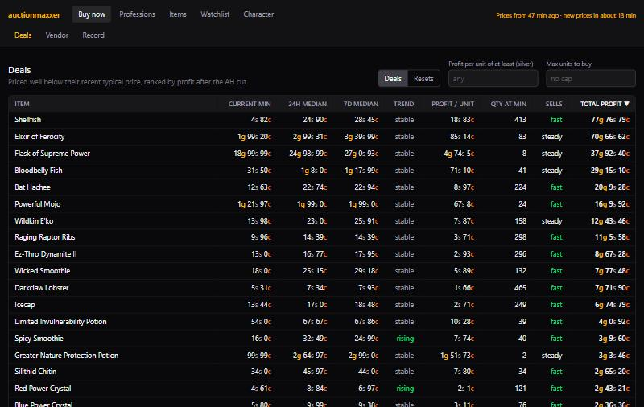
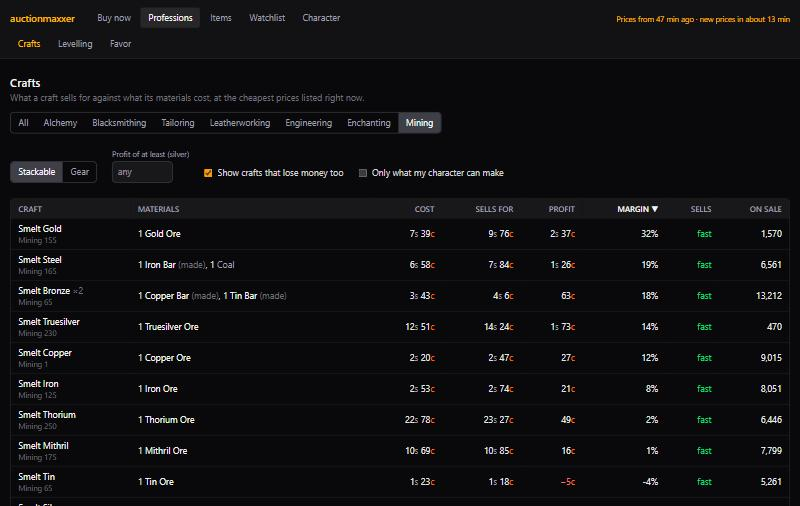
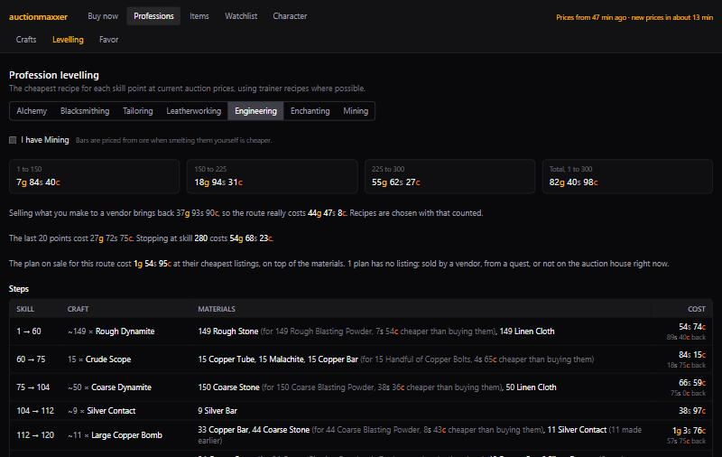
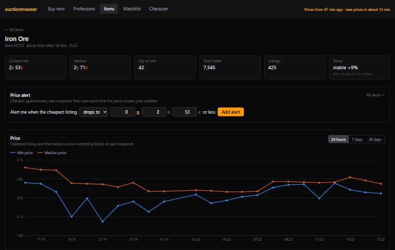
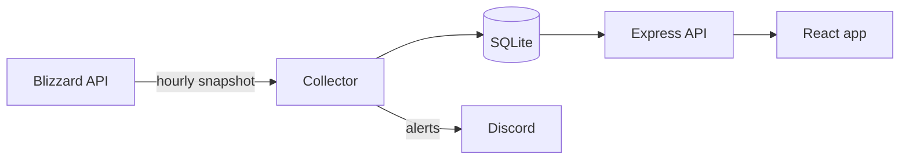

# auctionmaxxer

A personal market-analysis tool for the auction house in World of Warcraft: Forever. A collector stores an hourly
snapshot of the market from Blizzard's API, and a web app turns that history into answers: what is underpriced, which
crafts make money, and the cheapest way to level a profession at today's prices.

The running site is a private tool behind a login, so there is no public demo. The screenshots below use real market
data.



| Crafts: profit per craft at current prices | Levelling: the cheapest route through a profession |
|---|---|
|  |  |



## What it does

- **Deals and Resets:** finds items priced well under their 24-hour and 7-day medians, and cheap listings that could be
  bought out to raise the lowest price.
- **Crafts:** compares each recipe's materials with what the product sells for, walking the order book to work out how
  many crafts stay profitable.
- **Levelling planner:** builds the cheapest route from skill 1 to 300 for seven professions, using live prices and
  skill-up chances.
- **Vendor and Favor:** items listed below what a vendor pays, and the cheapest way to earn a reputation currency.
- **Track record:** saves each hour's top recommendations and checks a day later whether they would have made money.
- **Watchlist:** price rules and per-tab alerts, delivered through Discord.

## How it works



| Part | Technology |
|---|---|
| Server | Node 24, TypeScript, Express 5, better-sqlite3, zod |
| Web | React 19, Vite, Tailwind CSS 4, TanStack Query |
| Tests | `node:test`, 237 tests with no network access |
| Hosting | Ubuntu VPS, systemd services, Caddy for HTTPS and login, nightly database backups |

Each snapshot covers roughly 130,000 to 150,000 stackable listings, reduced to per-item price summaries and the cheapest
20 price levels. Prices are stored as whole copper, so there is no floating-point rounding.

## Problems worth a closer look

- **Estimating sales without sales data.** Blizzard reports listings, not sales.
  [`liquidity.ts`](server/src/liquidity.ts) infers demand from cheap units disappearing between snapshots. It is treated
  as a rough band (fast, steady, slow), because it cannot tell a sale from a cancelled listing.
- **Planning against a real order book.** Buying more of a material costs more, and the market can run out.
  [`levelling.ts`](server/src/levelling.ts) picks the cheapest recipe per skill point, prices each step from the listed
  quantities, and re-plans when a step cannot be bought in full.
- **Following a moving schedule.** Blizzard publishes hourly at a steady minute that shifts after server restarts.
  [`nextCheck.ts`](server/src/nextCheck.ts) times checks from the last update, which cut the delay before new prices
  appear from about 7 minutes to about 90 seconds.
- **Not trusting a pattern that isn't there.** Most items seemed to have a cheapest hour of the day, but it rarely
  repeated. [`hours.ts`](server/src/hours.ts) now names an hour only when odd and even days agree: 29 of 464 busy items
  passed, where about 6 would by chance.
- **Measuring its own advice.** The track record exists to catch recommendations that look good and lose money, and in
  the first week it showed exactly that for Deals.

## Running it locally

Requires Node 24. The mock data source needs no Blizzard account.

```bash
cd server
npm ci --ignore-scripts   # the database driver ships prebuilt, so nothing needs compiling
cp .env.example .env
npm run collect   # stores one snapshot of sample data
npm run api       # http://127.0.0.1:3001
```

In a second terminal:

```bash
cd web
npm ci
npm run dev       # http://localhost:5173
```

Run the checks with `npm test` in `server/`, and `npm run build` and `npm run lint` in `web/`.

## Notes

Built with [Claude Code](https://claude.com/claude-code) as a coding assistant; commits it contributed to are marked
with a `Co-Authored-By` line.

The code is published to be read, and no licence is granted for reuse. Auction data comes from Blizzard's Battle.net API.
This project is not affiliated with or endorsed by Blizzard Entertainment.
